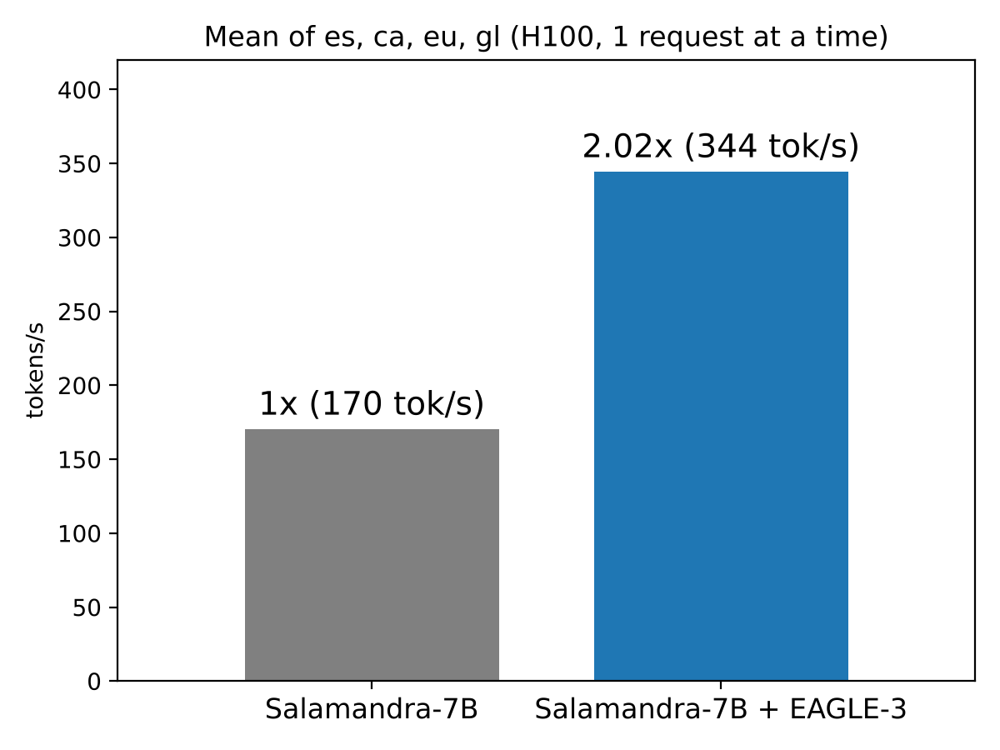
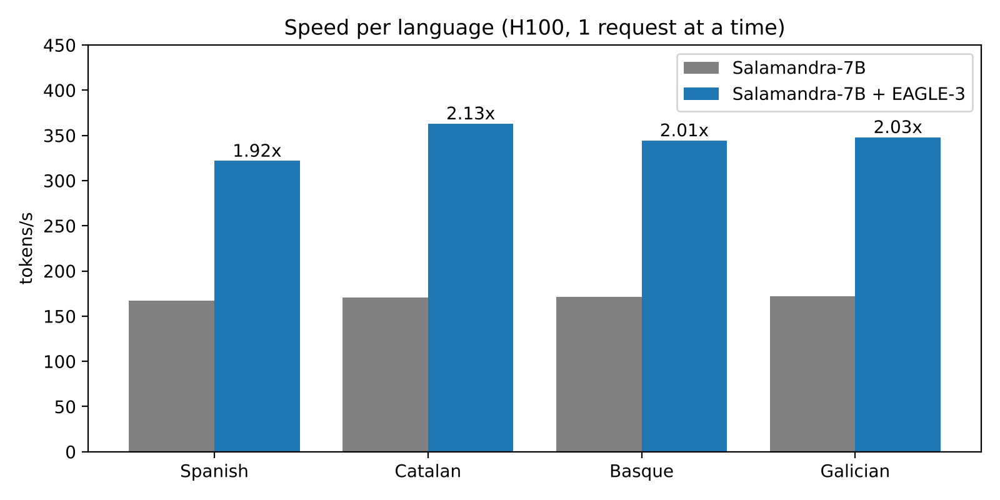
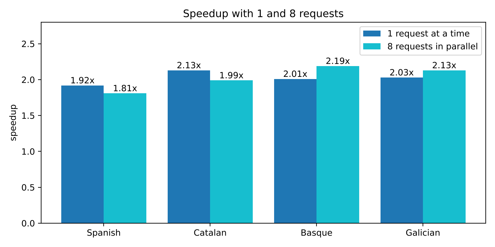

# salamandra-eagle3

I trained a small EAGLE-3 draft for Salamandra-7B in about an hour on one H100, and now it writes around 2x faster in Spanish, Catalan, Basque and Galician, with the same answers.

Salamandra-7B-Instruct-2606 is an LLM developed by the Barcelona Supercomputing Center (BSC), with special attention to Spanish, Catalan, Basque and Galician, four languages from the Iberian Peninsula.

For this experiment, I generated my own training dataset using prompts from ALIA-2606-SFT and regenerating the answers with Salamandra itself. I ended up with 19,010 conversations (30,973 assistant turns) and trained the draft for 3 epochs on a single H100 80GB, taking around 23 minutes per epoch.

  

## Data

To be able to use EAGLE-3 I need a dataset with questions I can use to generate with salamandra-7b some answers for my training data. In my case, since I'm interested in checking how EAGLE-3 accelerates Salamandra in languages from the iberian peninsula like Catalan, Basque and Galician and Spanish, I used another resource from the BSC, in this case the ALIA-2606-SFT dataset:
https://huggingface.co/datasets/BSC-LT/ALIA-2606-SFT

In this dataset's card we can find a language field which I've used to filter the questions I want.

I took 5000 conversations per language and regenerated the answers with Salamandra itself using vLLM and the regenerate-responses command from speculators, that way the draft learns from what Salamandra really answers and not from the original dataset answers. I dropped every conversation where a turn got cut at 4096 tokens and ended up with 19010 conversations (30973 assistant turns). I also kept a separate set of 50 prompts per language that I never trained on, just for the evaluation.
The resulting dataset:
https://huggingface.co/datasets/gabmerlo/salamandra-7b-instruct-2606-onpolicy-alia

## Training

I trained the draft with [speculators](https://github.com/vllm-project/speculators) in online mode on RunPod, with a single H100 80GB shared between vLLM (which gives the hidden states of Salamandra) and the training. 3 epochs, around 23 minutes each, with a reduced draft vocabulary of 32000 tokens.

Some things failed on the way and I left them commented in the notebook, for example I had to prepare the data with sequences of 4000 tokens instead of 4096 because otherwise the training asked vLLM for 0 tokens and crashed.

In the validation of the last epoch the draft gets right the 1st, 2nd and 3rd proposed token in a row 66%, 44% and 30% of the time.

Checkpoints are on Hugging Face: https://huggingface.co/gabmerlo/salamandra-7b-eagle3-alia

## Results

## Results

I measured on an H100 with vLLM 0.33.0, temperature 0, up to 512 new tokens and 3 speculative tokens per step, on 20 test prompts per language that the draft never saw in training.

  

With one request at a time, Salamandra goes from around 170 tokens/s to between 320 and 360 tokens/s, from 1.92x in Spanish to 2.13x in Catalan. All 80 answers came out identical to running Salamandra alone.

  

With 8 requests in parallel it still stays around 2x, between 1.81x and 2.19x.

On average the draft gets around 2.4 to 2.6 tokens accepted per step. It pays off because the EAGLE-3 head is tiny compared with Salamandra, so guessing costs almost nothing.

I also tried the 2B GPTQ models the BSC published as drafts, using vLLM's normal draft-model mode. They guess about as well as mine, but on my setup they don't speed Salamandra up. My guess is that with one request at a time a pass of the 2B costs almost as much as a pass of the 7B, and they were probably made for a different target model or vLLM version. The raw numbers I obtained are in `eval_comparacion_ibm/` on the model repo.

Limitations: one run per configuration, quite a few math prompts in the test set, and only 20 prompts per language.
